<p align="center">
  
  <br>
  <sub>Simple to use React Native library to get native device location for Android and iOS.</sub>
</p>

<p align="center">
  <b>React Native Get Location</b> provides a streamlined, lightweight API to request the device's current native location on Android and iOS. With zero bloat, native New Architecture (TurboModule) support, and unified error handling, obtaining a reliable GPS or network fix has never been easier.
</p>

<p align="center">
  <a href="LICENSE"></a>
  <a href="https://www.npmjs.com/package/react-native-get-location"></a>
  <a href="https://www.npmjs.com/package/react-native-get-location"></a>
  
  =0.71.0-61DAFB?style=flat-square&logo=react&logoColor=black" alt="React Native >= 0.71.0">
  
  <a href="https://github.com/douglasjunior/react-native-get-location/pulls"></a>
</p>

<p align="center">
  <a href="#quick-start"><b>Quick Start</b></a> ·
  <a href="#why-get-location">Why</a> ·
  <a href="#requirements">Requirements</a> ·
  <a href="#installation">Installation</a> ·
  <a href="#platform-configuration">Platform Configuration</a> ·
  <a href="#usage">Usage</a> ·
  <a href="#api-reference">API</a> ·
  <a href="#error-codes">Error Codes</a> ·
  <a href="#contributing">Contributing</a>
</p>

---

## Quick Start

<span id="quick-start"></span>

```bash
# 1. Install dependency
yarn add react-native-get-location
# or: npm i -S react-native-get-location

# 2. Install native CocoaPods dependencies (iOS)
cd ios && pod install
```

```tsx
import GetLocation, { Location, isLocationError } from 'react-native-get-location';

try {
  const location: Location = await GetLocation.getCurrentPosition({
    enableHighAccuracy: true,
    timeout: 60000,
  });

  console.log('Current coordinates:', location.latitude, location.longitude);
} catch (error) {
  if (isLocationError(error)) {
    const { code, message } = error;
    console.warn(`Location Error [${code}]:`, message);
  } else {
    console.warn('Unexpected error:', error);
  }
}
```

---

## Why Get Location?

<span id="why-get-location"></span>

- ⚡ **Zero Bloat & No Heavy SDKs.** Relies strictly on Android's native `LocationManager` and iOS's `CLLocationManager`. No Google Play Services dependencies or bulky binary frameworks required.
- 🏎️ **New Architecture Ready (TurboModule).** Engineered with React Native Codegen specs. Enjoy C++ TurboModule performance on New Architecture with seamless backward compatibility on the legacy bridge.
- 🎯 **Single Deterministic Call.** Avoid complex stream subscriptions when you only need a single location fix. Call `GetLocation.getCurrentPosition()` and receive a strongly-typed `Promise<Location>`.
- 🛡️ **Normalized Error Handling.** Cross-platform parity across all failure states with unified error codes: `CANCELLED`, `UNAVAILABLE`, `TIMEOUT`, and `UNAUTHORIZED`.
- 📱 **Built-in Android Permissions & Rationale.** Automatically requests fine or coarse permissions at runtime on Android, with native support for permission rationale dialogs.
- ⚙️ **Direct Settings Deep Link.** Includes `GetLocation.openSettings()` to quickly redirect users to your app's system settings if permissions were permanently denied.
- 🔋 **Battery Efficient.** Automatically unregisters native location listeners as soon as the first valid fix is acquired or the timeout expires.

---

## Requirements

<span id="requirements"></span>

| Requirement | Supported Version |
|---|---|
| **React Native** | `>= 0.71.0` |
| **iOS** | `>= 14.0` |
| **Android** | `>= API 21` (Android 5.0 Lollipop) |
| **Architecture** | Both New Architecture (TurboModule) & Legacy Architecture |

---

## Installation

<span id="installation"></span>

### 1. Install JavaScript Package

Using yarn:
```bash
yarn add react-native-get-location
```

Using npm:
```bash
npm i -S react-native-get-location
```

### 2. Configure iOS CocoaPods

Navigate to your `ios` folder and run `pod install`:

```bash
cd ios && pod install
```

> [!NOTE]
> If your project uses the New Architecture (`RCT_NEW_ARCH_ENABLED=1`), CocoaPods will automatically configure the TurboModule spec provider `RNGetLocationTurbo`.

---

## Platform Configuration

<span id="platform-configuration"></span>

### Android Setup

Add the required permissions inside `android/app/src/main/AndroidManifest.xml`:

```xml
<manifest xmlns:android="http://schemas.android.com/apk/res/android">

    <!-- Define ACCESS_FINE_LOCATION if you will use enableHighAccuracy=true (GPS) -->
    <uses-permission android:name="android.permission.ACCESS_FINE_LOCATION" />

    <!-- Define ACCESS_COARSE_LOCATION if you will use enableHighAccuracy=false (Wifi, Cellular) -->
    <uses-permission android:name="android.permission.ACCESS_COARSE_LOCATION" />

    <application ...>
        ...
    </application>
</manifest>
```

> [!IMPORTANT]
> - If you configure `enableHighAccuracy: true`, you **must** include `ACCESS_FINE_LOCATION`.
> - If you configure `enableHighAccuracy: false`, you **must** include at least `ACCESS_COARSE_LOCATION`.

### iOS Setup

Open `ios/YourAppName/Info.plist` and add the `NSLocationWhenInUseUsageDescription` key with a user-facing explanation:

```xml
<key>NSLocationWhenInUseUsageDescription</key>
<string>This app requires access to your location to show nearby services.</string>
```

---

## Usage

<span id="usage"></span>

### Basic Usage (Async / Await)

```tsx
import React, { useState } from 'react';
import { View, Text, Button, ActivityIndicator, StyleSheet } from 'react-native';
import GetLocation, { Location, LocationErrorCode, isLocationError } from 'react-native-get-location';

export default function LocationScreen() {
  const [loading, setLoading] = useState(false);
  const [location, setLocation] = useState<Location | null>(null);
  const [errorCode, setErrorCode] = useState<LocationErrorCode | null>(null);

  const requestPosition = async () => {
    setLoading(true);
    setLocation(null);
    setErrorCode(null);

    try {
      const position = await GetLocation.getCurrentPosition({
        enableHighAccuracy: true,
        timeout: 30000,
      });
      setLocation(position);
    } catch (error) {
      if (isLocationError(error)) {
        setErrorCode(error.code);
        console.warn('Location Error:', error.code, error.message);
      } else {
        console.warn('Unknown error:', error);
      }
    } finally {
      setLoading(false);
    }
  };

  return (
    <View style={styles.container}>
      <Button title="Get Current Location" onPress={requestPosition} disabled={loading} />

      {loading && <ActivityIndicator style={styles.spacing} />}

      {location && (
        <View style={styles.card}>
          <Text>Latitude: {location.latitude}</Text>
          <Text>Longitude: {location.longitude}</Text>
          <Text>Accuracy: ±{location.accuracy}m</Text>
          <Text>Altitude: {location.altitude}m</Text>
          <Text>Speed: {location.speed} m/s</Text>
          <Text>Time: {new Date(location.time).toLocaleString()}</Text>
        </View>
      )}

      {errorCode && <Text style={styles.errorText}>Error Code: {errorCode}</Text>}
    </View>
  );
}

const styles = StyleSheet.create({
  container: { flex: 1, justifyContent: 'center', alignItems: 'center', padding: 16 },
  spacing: { marginTop: 16 },
  card: { marginTop: 16, padding: 16, backgroundColor: '#f0f4f8', borderRadius: 8 },
  errorText: { marginTop: 16, color: '#e53e3e', fontWeight: 'bold' },
});
```

---

### High Accuracy (GPS) vs Standard / Network Location

You can balance precision and battery speed using `enableHighAccuracy`:

```tsx
// 1. High Accuracy (GPS fix)
const preciseLocation = await GetLocation.getCurrentPosition({
  enableHighAccuracy: true,
  timeout: 60000,
});

// 2. Coarse Accuracy (Cell tower, Wi-Fi, faster fix, lower battery consumption)
const quickLocation = await GetLocation.getCurrentPosition({
  enableHighAccuracy: false,
  timeout: 15000,
});
```

---

### Android Permission Rationale

On Android, you can provide an explanation dialog before prompting the system permission modal:

```tsx
const location = await GetLocation.getCurrentPosition({
  enableHighAccuracy: true,
  timeout: 60000,
  rationale: {
    title: 'Location Permission',
    message: 'We need your location to show places near you.',
    buttonPositive: 'Grant Permission',
    buttonNegative: 'Cancel',
  },
});
```

---

### Handling Permission Denials & Opening App Settings

When a user permanently denies location permission, `GetLocation.getCurrentPosition()` rejects with error code `'UNAUTHORIZED'`. You can prompt the user and deep-link directly into system settings via `GetLocation.openSettings()`:

```tsx
try {
  const loc = await GetLocation.getCurrentPosition({
    enableHighAccuracy: true,
    timeout: 30000,
  });
} catch (error) {
  if (isLocationError(error) && error.code === 'UNAUTHORIZED') {
    // Direct user to system settings to grant permission manually
    GetLocation.openSettings();
  }
}
```

For a complete working sample, explore the [Sample Project](https://github.com/douglasjunior/react-native-get-location/blob/master/Sample/App.tsx).

---

## API Reference

<span id="api-reference"></span>

All methods, types, and error helpers are exported from `'react-native-get-location'`.

### Methods

#### `GetLocation.getCurrentPosition(options?: GetCurrentPositionOptions): Promise<Location>`

Requests the device's current geographical fix and returns a Promise that resolves with a [`Location`](#location-object) object.

**Parameters:**

| Parameter | Type | Required | Description |
|---|---|:---:|---|
| `options` | [`GetCurrentPositionOptions`](#getcurrentpositionoptions) | No | Configuration object for accuracy, timeout, and Android rationale. |

**Returns:**
- `Promise<Location>`: Resolves to the current [`Location`](#location-object) fix. Rejects with [`LocationError`](#locationerror).

---

#### `GetLocation.openSettings(): Promise<any>`

Opens the current application's system settings screen (e.g. to enable location permissions manually). Calls React Native's `Linking.openSettings()` under the hood.

---

### Types & Interfaces

#### `GetCurrentPositionOptions`

Configuration options passed to `GetLocation.getCurrentPosition()`.

| Property | Type | Default | Description |
|---|---|---|---|
| `enableHighAccuracy` | `boolean` | `false` | When `true`, uses fine location (GPS). When `false`, uses coarse location (Wi-Fi, Bluetooth, 3G/4G). |
| `timeout` | `number` | `60000` | Maximum duration (in milliseconds) to wait for a location fix before throwing a `TIMEOUT` error. |
| `rationale?` | `Rationale` | `undefined` | *(Android only)* Custom rationale dialog options passed to React Native's `PermissionsAndroid.request()`. |

---

#### `Location` Object

The resolved geolocation object.

| Property | Type | Platform | Description |
|---|---|---|---|
| `latitude` | `number` | Both | The latitude, in degrees. |
| `longitude` | `number` | Both | The longitude, in degrees. |
| `altitude` | `number` | Both | The altitude if available, in meters above the WGS 84 ellipsoid. |
| `accuracy` | `number` | Both | Estimated horizontal accuracy of the fix, radial, in meters. |
| `speed` | `number` | Both | Ground speed if available, in meters/second. |
| `time` | `number` | Both | UTC timestamp of this fix, in milliseconds since Unix Epoch. |
| `bearing` | `number?` | Android only | Direction of travel in degrees (0.0 to 359.9). |
| `provider` | `string?` | Android only | Name of the native provider that generated this fix (e.g., `'gps'`, `'network'`). |
| `verticalAccuracy` | `number?` | iOS only | Vertical accuracy of the altitude in meters. Negative if invalid. |
| `course` | `number?` | iOS only | Course in degrees true North (0.0 to 359.9). Negative if invalid. |

---

#### `LocationError`

Custom error instance thrown when location acquisition fails.

```ts
export class LocationError extends Error {
  code: LocationErrorCode;
}
```

#### `isLocationError(error: unknown): error is LocationError`

Type guard utility to determine if an unknown caught exception is a `LocationError`.

---

## Error Codes

<span id="error-codes"></span>

When a position request fails, the promise rejects with a `LocationError` containing one of the following normalized codes:

| Code | Canonical Message | Cause & Recommended Action |
|---|---|---|
| `CANCELLED` | `"Location cancelled by user or by another request"` | A new `getCurrentPosition` call was triggered before the previous one completed, or the OS canceled the request. Avoid duplicate simultaneous requests. |
| `UNAVAILABLE` | `"Location service is disabled or unavailable"` | Location services / GPS hardware are turned off in system settings or unavailable on the device. Prompt user to turn location services on. |
| `TIMEOUT` | `"Location timed out"` | The device could not acquire a satellite or network fix within the configured `timeout` window. Increase timeout or toggle `enableHighAccuracy`. |
| `UNAUTHORIZED` | `"Location permission denied by the user"` | The user denied location permissions. Use `GetLocation.openSettings()` to guide the user to the app permissions settings screen. |

---

## Contributing

<span id="contributing"></span>

New features, bug fixes, and documentation improvements are welcome!

1. Fork the repository and create a descriptive topic branch.
2. Ensure TypeScript builds cleanly (`yarn build`).
3. Open a pull request describing your changes.

For questions and suggestions, please open an [issue](https://github.com/douglasjunior/react-native-get-location/issues).

### Support the Author

If this library saved you time, consider supporting the maintainer:

<p align="left">
  <a href="https://www.patreon.com/douglasjunior"></a>
  &nbsp;
  <a href="https://paypal.me/douglasnassif"></a>
</p>

---

## Star History

<span id="star-history"></span>

<p align="center">
  <a href="https://star-history.com/#douglasjunior/react-native-get-location&Date">
    <picture>
      <source media="(prefers-color-scheme: dark)" srcset="https://api.star-history.com/svg?repos=douglasjunior/react-native-get-location&type=Date&theme=dark" />
      
    </picture>
  </a>
</p>

---

## License

<span id="license"></span>

```text
The MIT License (MIT)

Copyright (c) 2019 Douglas Nassif Roma Junior
```

See the full [license file](LICENSE).

---

## Author & More Projects

<span id="author--more-projects"></span>

<p align="center">
  <a href="https://douglasjunior.work">
    
  </a>
</p>

<p align="center">
  Discover more open-source libraries, creative animation engines, and developer tools at <a href="https://douglasjunior.work"><b>douglasjunior.work</b></a>.
</p>